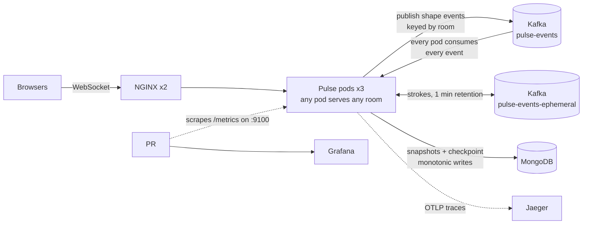
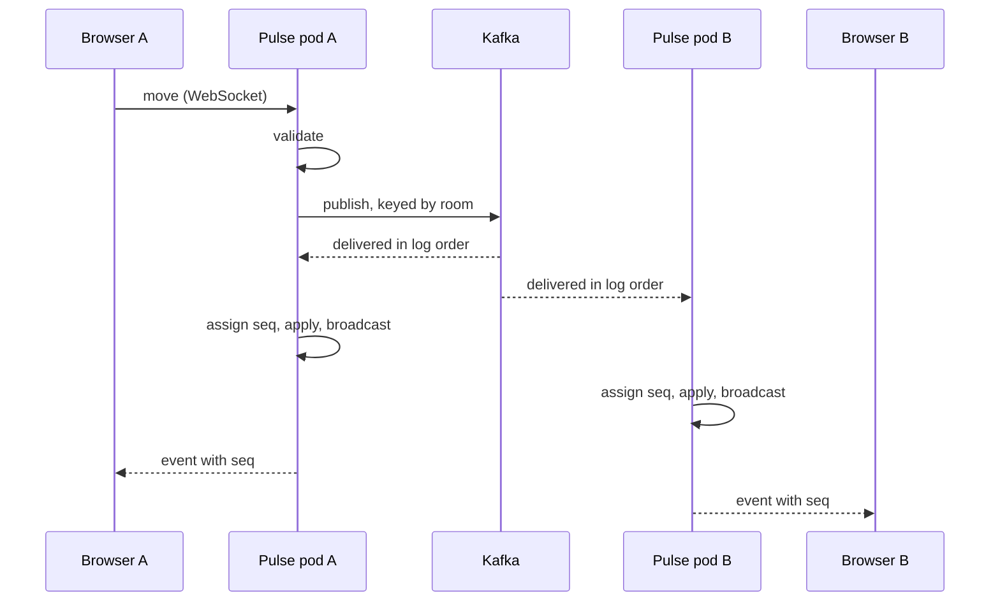

# Pulse

A realtime collaborative whiteboard. Students join a room, draw and move shapes,
and everyone sees every change instantly, whichever server they are connected to.

Go handles the WebSocket traffic, **Kafka is the source of truth** (an ordered,
replayable event log), MongoDB holds snapshots that keep restarts fast, and
Kubernetes runs three interchangeable Go pods behind NGINX. Prometheus, Grafana and
Jaeger show what it is doing.


## Architecture



### The life of one event



A client sees its own action only when it comes back from the log, so anything
a user has seen is already in the log (on one broker's disk). Every pod applies
the same events in the same order, so they agree on every sequence number
without talking to each other.

## Key decisions

All of them, with the alternatives and trade-offs, are in
[DECISIONS.md](DECISIONS.md). The ones that shape the system:

| Question | Decision |
|---|---|
| Who owns room state in a pod? | One hub goroutine, reached only through channels (1, 2, 3) |
| What is the source of truth? | The Kafka log; seq is assigned when an event is consumed (5, 18) |
| How do restarts stay fast? | Mongo snapshots that record the log offset they cover (19) |
| Can several pods write snapshots? | Yes: writes are monotonic and never move backward (22) |
| How does undo work in a shared room? | The client sends a compensating event; the log stays append-only (20) |
| What about freehand strokes? | A short-retention topic, never replayed (21) |
| Why no session affinity? | Any pod can serve any room, so a pod kill is a non-event (27) |
| Why plain NGINX, not an ingress controller? | ingress-nginx is retired (26) |

## Testing

```bash
go test -race ./...
```

Unit tests drive the hub with fake clients and a fake store. Integration tests run
the real WebSocket handler, including **two and three instances on a simulated
log** that behaves like Kafka (one total order, fan-out, replay). Store tests run
against a scratch Mongo database when one is reachable. The real Kafka client is
verified manually rather than by automated tests; see [Run it](#run-it) and
[Try breaking it](#try-breaking-it) for the end-to-end checks.

## Run it

Prerequisites: Docker Desktop, [kind](https://kind.sigs.k8s.io), kubectl, Helm, Go.

```bash
kind create cluster --config deploy/kind.yaml
kubectl create namespace pulse && kubectl config set-context --current --namespace=pulse
kubectl apply -f deploy/infra/
kubectl wait --for=condition=complete job/create-topics --timeout=180s

docker build -t pulse:dev . && kind load docker-image pulse:dev --name pulse
bash deploy/observability/apply.sh
helm upgrade --install pulse deploy/helm/pulse
```

On macOS, run `open "http://localhost:8080/?room=demo"`; otherwise, visit
<http://localhost:8080/?room=demo> in a browser.

Dashboards: `kubectl port-forward svc/grafana 3000:3000` (Grafana),
`svc/jaeger 16686:16686` (traces), `svc/prometheus 9090:9090`.

### Try breaking it

Start drawing in a room, list the Pulse pods, then force-delete one. The browser
should reconnect and the drawing should remain:

```bash
kubectl get pods -l app.kubernetes.io/name=pulse
kubectl delete pod pulse-xxxxx-yyyyy --grace-period=0 --force  # use a name from the list above
```

## Observability

- **Metrics** (`:9100`, not routed through NGINX): connections, message and event
  rates, publish-to-apply latency, hub broadcast time, dropped slow clients,
  log lag, snapshot health, replay duration.
- **Traces**: one trace follows an event from the WebSocket on one pod, through
  Kafka, to the apply on every pod, with the context carried in Kafka headers.

## Performance

Measured on one laptop: a 16-CPU, 7.75 GiB Docker Desktop VM running the kind
cluster, with the load generator on the same machine. Treat these as figures for
this setup, not as capacity limits of the design.

Each run lasts 60 s: clients connect over 10 s, then each sends 2 shape events per
second (about 60% moves, 20% adds, 20% deletes). Echo latency is end to end: the
time from a client sending a shape until that shape comes back from the log, as
whole-run percentiles. Where a row gives a range it is the min-max over the runs
shown; rows without a run count are single runs.

| Clients | Rooms | Events/s offered | Peak outbound msgs/s | Echo p50 / p95 | Clients dropped |
|---|---|---|---|---|---|
| 50 | 10 | 100 | 500 | 17 ms / 23 ms | 0 |
| 200 | 20 | 400 | 4,000 | 16 ms / 35-36 ms (3 runs) | 0 |
| 300 | 20 | 600 | 9,200 | 29-31 ms / 134-138 ms (2 runs) | 0 |
| 400 | 20 | 800 | 14,300-17,900 | 45 ms-5.6 s / 0.15-16.1 s (6 runs) | 0-5 (4 of 6 runs recorded) |
| 800 | 20 | 1,600 | 36,500-44,500 (2 of 3 runs recorded) | 6.2-11.6 s / 17.6-31.1 s (3 runs) | 6-71 (2 of 3 runs recorded) |
| 1,500 | 20 | 3,000 | 39,200 | 12.8 s / 38.2 s | 1 |
| 200 | 1 | 400 | 30,000 | 48 ms / 139 ms | 78 |
| 200 | 4, plus 2,000 strokes/s | 400 | 30,300 | 87 ms / 222 ms | 127 |

Findings:

- **Up to 300 clients (600 events/s) every run coped**: p95 stayed under 140 ms.
  At 800 and 1,500 clients every run fell far behind.
- **400 clients (800 events/s) is the edge.** Of six runs, two coped (p95 0.15 s
  and 0.31 s) and four fell behind (p95 3.5-16.1 s). Four runs were confirmed
  to start with measured lag below 10 records; they gave p95 of 0.15, 3.5, 9.5,
  and 16.1 s. The other two starts' backlog state was not recorded. This spread
  is consistent with a system near capacity where small differences in
  available CPU can flip a run between coping and falling behind, but the cause
  is not established. For this setup the edge is roughly 600-800 events/s.
- **Overload latencies are lower bounds and depend on run length.** A backlog
  grows for as long as the load lasts, and events still queued when a run ends
  are never timed. In the 800-client run that counted unreturned adds, 5,252 of
  18,641 adds (28.2%) had not echoed by the end; a small part belongs to the 71
  clients the generator reported dropped, which could no longer receive their
  echoes. Read the 800- and 1,500-client latencies as "at least this bad, after
  60 s".
- **Fan-out is the multiplier.** Outbound traffic is events per second times
  clients per room. The same offered input in one room produced about 7.5 times
  the peak outbound traffic of the 20-room run, and the generator reported 78
  closed connections in that run. In a separate single-room rerun the generator
  counted 61 drops and the server's slow-client counter rose by 69: the same
  order, which suggests most were server-side slow-client drops, though the
  difference is unexplained.
- **Observed outbound peaks reached about 44.5k messages/s** in an 800-client
  run. This is a measurement from this setup, not a capacity limit.
- **Overload degrades quietly.** At 800 and 1,500 clients latency grew to seconds
  while most clients stayed connected: the slow-client rule protects against
  slow receivers, but nothing limits incoming load.
- **Diagnosis.** Under overload the pods fall behind the log. In an 800-client
  run every pod's consumer lag grew to about 56-61k records, while the fullest
  per-client send queue stayed at 29 of 64 slots and each pod used about 2 CPU
  cores. The queue gauge is sampled once a second, so brief fills between
  samples may be missed; one 800-client run also dropped 71 clients. The
  consume/apply path is the primary limit, with slow receivers a secondary
  effect. Because every pod applies every event, adding pods adds connection
  capacity but, by design, not apply capacity; this was not tested.
- Pod memory stayed modest: about 133 MiB at most in the heaviest run, about
  104 MiB over the last six hours of metrics, and no restarts.
- **Replaying the whole log** (354,190 records, no snapshots, no clients) took
  4.2 s, about 85,000 records/s. With snapshots a restart usually replays nothing.

No single number characterises the system near its edge, and the generator shares
the machine with the cluster, so these figures describe this laptop, not the
design.

Run it yourself: `go run ./cmd/loadgen -clients 200 -rooms 20 -rate 2`.

## Limitations and next steps

- **No authentication or authorization.** Anyone with a room's URL can join and
  edit it, and the WebSocket origin check is disabled (a development shortcut).
- **Ingress is unbounded.** Add per-connection rate limits and a bounded publish
  queue that sheds load instead of letting latency grow.
- **The apply path is not profiled.** The metrics show the pods fall behind the
  log, but no CPU profile has identified the hot spot yet; pprof is the next
  step.
- **Scale-out covers connections, not apply rate.** Every pod holds every room's
  board and applies every event, so more replicas do not raise the apply rate (by
  design; not tested). Routing rooms to pods would fix this, at the cost of the
  simplicity that makes a pod kill a non-event.
- The event log is never truncated (retention is infinite); a long-lived
  deployment would need to compact or archive history behind the snapshot
  checkpoint.
- Mouse-move events are sent one by one; batching would cut message volume.
- Kafka and Mongo are single replicas, so "durable" means one broker's disk;
  NGINX is not instrumented; Jaeger and Prometheus keep data in memory only; the
  demo Grafana has no login.
- Undo history lives in the browser and is lost on refresh; there is no redo.
- The latency metric assumes pod clocks agree, which is true on one host only.

## Layout

```
cmd/server      the service        cmd/loadgen   load generator
internal/hub    rooms, boards, events, metrics, tracing hooks
internal/eventlog   Kafka log, replay, strokes topic
internal/store  Mongo snapshots and checkpoint
web/            canvas client
docs/           demo GIF
deploy/         kind config, infra manifests, Helm chart, observability
```