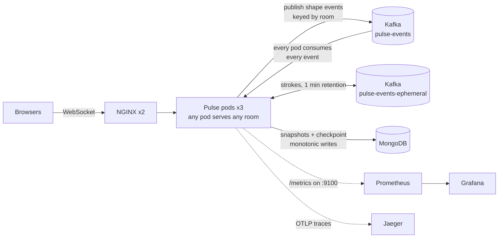
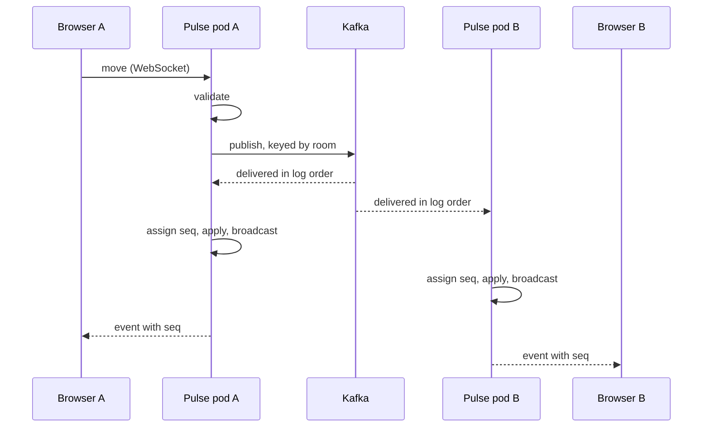

# Pulse

A realtime collaborative whiteboard. Students join a room, draw and move shapes,
and everyone sees every change instantly, whichever server they are connected to.

Go handles the WebSocket traffic, **Kafka is the source of truth** (an ordered,
replayable event log), MongoDB holds snapshots that keep restarts fast, and
Kubernetes runs three interchangeable Go pods behind NGINX. Prometheus, Grafana and
Jaeger show what it is doing.


## Architecture



### The life of one event



A client sees its own action only when it comes back from the log, so anything
a user has seen is already durable. Every pod applies the same events in the same
order, so they agree on every sequence number without talking to each other.

## Key decisions

All of them, with the alternatives and trade-offs, are in
[DECISIONS.md](DECISIONS.md). The ones that shape the system:

| Question | Decision |
|---|---|
| Who owns room state in a pod? | One hub goroutine, reached only through channels (1, 2, 3) |
| What is the source of truth? | The Kafka log; seq is assigned when an event is consumed (5, 18) |
| How do restarts stay fast? | Mongo snapshots that record the log offset they cover (19) |
| Can several pods write snapshots? | Yes: writes are monotonic and never move backward (22) |
| How does undo work in a shared room? | The client sends a compensating event; the log stays append-only (20) |
| What about freehand strokes? | A short-retention topic, never replayed (21) |
| Why no session affinity? | Any pod can serve any room, so a pod kill is a non-event (27) |
| Why plain NGINX, not an ingress controller? | ingress-nginx is retired (26) |

## Testing

```bash
go test -race ./...
```

Unit tests drive the hub with fake clients and a fake store. Integration tests run
the real WebSocket handler, including **two and three instances on a simulated
log** that behaves like Kafka (one total order, fan-out, replay). Store tests run
against a scratch Mongo database when one is reachable. The real Kafka client is
covered by the manual checks in `DECISIONS.md`, not by automated tests.

## Run it

Prerequisites: Docker Desktop, [kind](https://kind.sigs.k8s.io), kubectl, Helm, Go.

```bash
kind create cluster --config deploy/kind.yaml
kubectl create namespace pulse && kubectl config set-context --current --namespace=pulse
kubectl apply -f deploy/infra/
kubectl wait --for=condition=complete job/create-topics --timeout=180s

docker build -t pulse:dev . && kind load docker-image pulse:dev --name pulse
helm upgrade --install pulse deploy/helm/pulse
bash deploy/observability/apply.sh

open "http://localhost:8080/?room=demo"
```

Dashboards: `kubectl port-forward svc/grafana 3000:3000` (Grafana),
`svc/jaeger 16686:16686` (traces), `svc/prometheus 9090:9090`.

Try breaking it: `kubectl delete pod <one of the pulse pods> --grace-period=0 --force`
while drawing. The tab reconnects within about a second and shows the same board.

## Observability

- **Metrics** (`:9100`, not routed through NGINX): connections, message and event
  rates, publish-to-apply latency, hub broadcast time, dropped slow clients,
  log lag, snapshot health, replay duration.
- **Traces**: one trace follows an event from the WebSocket on one pod, through
  Kafka, to the apply on every pod, with the context carried in Kafka headers.

## Performance

Measured on one laptop: a 16-CPU, 7.75 GiB Docker Desktop VM running the kind
cluster, with the load generator on the same machine. Treat these as figures for
this setup, not as capacity limits of the design.

| Clients | Rooms | Events/s offered | Peak outbound msgs/s | Echo p50 / p95 | Clients dropped |
|---|---|---|---|---|---|
| 50 | 10 | 100 | 500 | 17 ms / 23 ms | 0 |
| 200 | 20 | 400 | 4,000 | 18 ms / 36 ms | 0 |
| 400 | 20 | 800 | 16,000 | 110 ms / 307 ms | 0 |
| 200 | 1 | 400 | 30,000 | 48 ms / 139 ms | 78 |
| 200 | 4, plus 2,000 strokes/s | 400 | 30,300 | 87 ms / 222 ms | 127 |
| 800 | 20 | 1,600 | 36,500 | 7.9 s / 19.8 s | 6 |
| 1,500 | 20 | 3,000 | 39,200 | 12.8 s / 38.2 s | 1 |

Echo latency is end to end: the time from a client sending a shape until that
shape comes back from the log. Findings:

- **Responsive up to about 400 events/s; the knee is between 400 and 800.**
- **Fan-out is the multiplier.** Outbound traffic is events per second times
  clients per room. The same offered input in one room produced about 7.5 times
  the peak outbound traffic of the 20-room run and made the server shed clients.
- **Outbound throughput plateaus at 30-39k messages/s** while the Docker VM's
  CPUs were saturated, so that figure is the capacity of this setup.
- **Overload degrades quietly.** At 800 and 1,500 clients, latency grew to seconds
  with almost no disconnects: the slow-client rule protects against slow
  receivers, but nothing limits incoming load.
- **Diagnosis:** *(fill in after the lag and send-queue experiment)*
- Memory stayed under 135 MiB per pod, with no restarts.
- **Replaying the whole log** (354,190 records, no snapshots, no clients) took
  4.2 s, about 85,000 records/s. With snapshots a restart usually replays nothing.

Run it yourself: `go run ./cmd/loadgen -clients 200 -rooms 20 -rate 2`.

## Limitations and next steps

- Ingress is unbounded: add per-connection rate limits and a bounded publish
  queue that sheds load instead of letting latency grow.
- Every pod holds every room's board and applies every event; routing rooms to
  pods would trade simplicity for memory and CPU.
- Mouse-move events are sent one by one; batching would cut message volume.
- Kafka and Mongo are single replicas; NGINX is not instrumented; Jaeger and
  Prometheus keep data in memory only; the demo Grafana has no login.
- The latency metric assumes pod clocks agree, which is true on one host only.

## Layout

```
cmd/server      the service        cmd/loadgen   load generator
internal/hub    rooms, boards, events, metrics, tracing hooks
internal/eventlog   Kafka log, replay, strokes topic
internal/store  Mongo snapshots and checkpoint
deploy/         kind config, infra manifests, Helm chart, observability
```